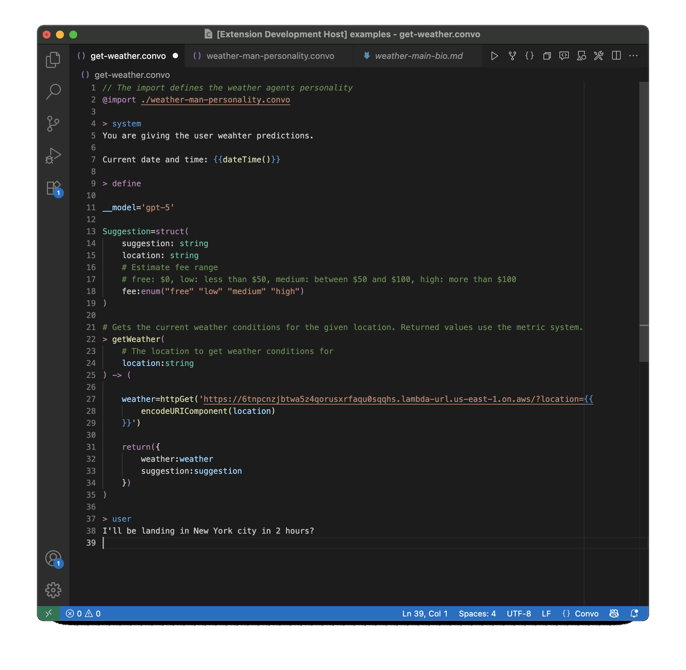
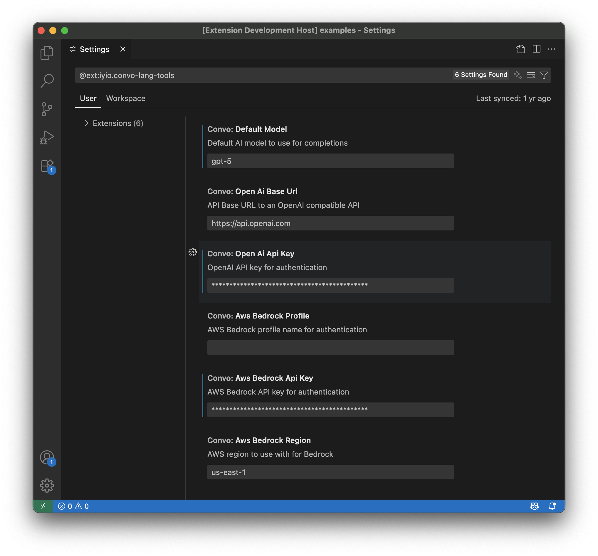

# Convo-Lang for VSCode
VSCode tools for Convo-Lang



**Learn Convo-Lang with Live Demos** - [https://learn.convo-lang.ai](https://learn.convo-lang.ai)

**GitHub** - [https://github.com/convo-lang/convo-lang](https://github.com/convo-lang/convo-lang)

**VSCode Marketplace** - [https://marketplace.visualstudio.com/items?itemName=iyio.convo-lang-tools](https://marketplace.visualstudio.com/items?itemName=iyio.convo-lang-tools)

**NPM** - [https://www.npmjs.com/package/@convo-lang/convo-lang-tools](https://www.npmjs.com/package/@convo-lang/convo-lang-tools)


## Index
- [What is Convo-Lang for VSCode?](#what-is-convo-lang-for-vscode)
- [Install](#install)
- [Settings](#settings)
- [Quick Start](#quick-start)
- [Prompts as Source Files](#prompts-as-source-files)
- [Example Workflows](#example-workflows)
- [File Blocks and Bash Blocks](#file-blocks-and-bash-blocks)
- [Working with Output Blocks](#working-with-output-blocks)
- [Commands](#commands)
- [Editor Features](#editor-features)
- [Convo-Make in VSCode](#convo-make-in-vscode)
- [Model Support](#model-support)
- [About Convo-Lang](#about-convo-lang)
- [Contact](#contact)


## What is Convo-Lang for VSCode?

> "Convo-Lang for VSCode is the manual transmission of the agentic world, you are in full control"

Convo-Lang for VSCode is the VSCode extension for writing, running and managing Convo-Lang
conversations directly inside the editor.

Conversations live in plain `.convo` files. Each completion is appended to the file, so prompts,
responses, generated files and script output stay readable, diffable and committed to source
control.

Nothing is written to your project or executed without your say. Generated files are reviewed and
diffed before they are written. Scripts ask for confirmation before they run.

With the extension you can:

- Author and run `.convo` files with syntax highlighting, autocomplete and clickable imports
- Build reusable prompt templates and extend them into dated, task-specific conversations
- Answer an assistant's numbered questions in a split view
- Review, diff and write `FILE_CONTENT` blocks generated by the model
- Run `RUNNABLE_SCRIPT` blocks and feed their output back into the conversation
- Inspect flattened conversations, variables, messages and provider-native requests
- Run embedded Convo snippets from JavaScript, TypeScript, Python and Markdown
- Build and manage Convo-Make targets


## Install

Install the extension from the VSCode Marketplace:

https://marketplace.visualstudio.com/items?itemName=iyio.convo-lang-tools

After installing, open the extension settings and configure an API key for OpenAI, OpenRouter, AWS
Bedrock or any OpenAI compatible provider. You can open the settings by clicking the tools (🛠️)
icon in the top right of any `.convo` file, or by running `Convo: Open Settings`.




## Settings

| Setting                        | Default                    | Description                                                                                |
|--------------------------------|----------------------------|--------------------------------------------------------------------------------------------|
| `convo.defaultModel`           | `gpt-4.1`                  | Default AI model to use for completions                                                    |
| `convo.openAiBaseUrl`          | `https://api.openai.com`   | API base URL of an OpenAI compatible API                                                   |
| `convo.openAiApiKey`           |                            | OpenAI, or OpenAI compatible, API key                                                      |
| `convo.openRouterBaseUrl`      | `https://openrouter.ai/api`| API base URL of OpenRouter                                                                 |
| `convo.openRouterApiKey`       |                            | OpenRouter API key                                                                         |
| `convo.awsBedrockProfile`      |                            | AWS profile name used for Bedrock                                                          |
| `convo.awsBedrockApiKey`       |                            | AWS Bedrock API key                                                                        |
| `convo.awsBedrockRegion`       | `us-east-1`                | AWS region used for Bedrock                                                                |
| `convo.notifyOnCompletion`     | `true`                     | Show a notification when a completion finishes for a document that is not the active editor |
| `convo.alwaysRunOutputScripts` | `false`                    | Run `RUNNABLE_SCRIPT` blocks without a confirmation prompt                                 |

When a `convo.*` setting changes, other than `convo.notifyOnCompletion`, the extension asks you to
reload the window so the change takes effect.


## Quick Start

### 1. Create a `.convo` file

Create a file such as `hello.convo`, or run `Convo: New File` (`Shift+Alt+Ctrl+N` / `Shift+Alt+Cmd+N`).

```convo
> system
You are a concise engineering assistant.

> user
Summarize the tradeoffs between REST and GraphQL.
```

### 2. Run the conversation

Do any one of the following:

- Click the play button in the top right of the editor
- Run `Convo: Complete` from the Command Palette
- Press `Ctrl+R` (Windows/Linux) or `Cmd+R` (macOS)

### 3. Keep going

The assistant's response is appended to the file, followed by a new `> user` message. The file is
saved automatically. Type your next message and complete again.

Completions run in the background, so you can switch to other files while one is running. If the
document isn't in the active editor when the completion finishes, a notification appears with an
`Open` button.


## Prompts as Source Files

Because conversations are plain files, prompting becomes part of your project like any other
source file. A common approach is a `convo` folder at the project root.

- Shared behavior lives in base files.
- Area-specific context lives in template files that start with an underscore.
- Each task is its own dated conversation file that extends a template.

```text
- project root
    |
    + - (other project folders and files ...)
    |
    + - convo
        |
        + - base.convo: Defines common project wide behavior
        |
        + - coding-style.md: Markdown file describing the coding style of the project
        |
        + - frontend: Folder containing conversations specific to the frontend
        |   |
        |   + - _frontend.convo: Contains a system prompt and context files specific to the frontend
        |   |
        |   + - frontend-2026-11-06-0001-convert_to_tailwinds.convo
        |
        + - backend: Folder containing conversations specific to the backend
            |
            + - _backend.convo
```

`convo/base.convo`
```convo
@import std://file-blocks.convo
@import ./coding-style.md !tag:CODING_STYLE

> define
__model='open-router/anthropic/claude-opus-5.5'


> system
You are a pragmatic coding assistant that prefers clean minimalist code.

Before generating a response for the user always ask them any questions you may have to clarify and
when possible present them with multi-choice options. Do not respond with XML File Blocks before receiving
confirmation from the user. Avoid using unnecessary markdown formatting such as large amounts of bolding
in your questions, the user will be reading the questions as raw markdown.
```

`convo/frontend/_frontend.convo`
```convo
@import ../base.convo
@import ../../src/index.html
@import ../../docs/style-guide.md

> system
You are making changes to the frontend index.html file
```

`convo/frontend/frontend-2026-11-06-0001-convert_to_tailwinds.convo`
```convo
@import ./_frontend.convo !template

> user
Convert the style system to Tailwinds V4
```

Why this works well:

- Every prompt, response and generated file is committed alongside the code it changed. You can
  see in `git log` why a change was made.
- Template files such as `_frontend.convo` keep context and rules in one place. Improving a
  template improves every future conversation that extends it.
- Context files such as `index.html` and `style-guide.md` are imported from the project, so the
  model always sees the current version.
- Dated file names sort naturally and never collide. Numbers increase automatically within a day.
- Teammates can open any conversation, read exactly what was asked, and continue or fork it.


## Example Workflows

### Templates with Answer Questions Split (recommended)

This workflow combines templates, clarifying questions and review-first file edits. It uses the
layout from [Prompts as Source Files](#prompts-as-source-files).

1. Open `convo/frontend/_frontend.convo`.
2. Press `Ctrl+Shift+K` / `Cmd+Shift+K` (`Convo: Extend Template Named`) and enter
   `convert_to_tailwinds`. The extension creates
   `frontend-2026-11-06-0001-convert_to_tailwinds.convo` containing
   `@import ./_frontend.convo !template` and an empty `> user` message.
3. Type the task, for example `Convert the style system to Tailwinds V4`, and press
   `Ctrl+R` / `Cmd+R`.
4. The system prompt in `base.convo` tells the model to ask questions first, so it responds with
   numbered, multi-choice questions:

    ```convo
    > assistant
    1. How should Tailwind be loaded?
       - a) CDN using @tailwindcss/browser
       - b) Tailwind CLI build step
    2. Should the existing CSS file be removed after conversion?
       - a) Yes
       - b) No, keep it for reference
    ```

5. Press `Ctrl+Shift+L` / `Cmd+Shift+L` (`Convo: Answer Questions Split`). The extension:
    - splits the editor
    - collapses the side bar
    - sizes the left editor to 2/3 of the window so the questions stay readable
    - enables word wrap
    - adds numbered placeholders to a new `> user` message in the right editor, with the cursor
      after `1. `

    ```convo
    > user
    1. a
    2. b
    ```

6. Fill in the answers and press `Ctrl+R` / `Cmd+R`.
7. The model responds with `FILE_CONTENT` blocks. Use the `Open Diff` code lens, or the Code
   Blocks view, to review each change. Then use `Write Output` or `Apply All` to write the files.
8. Commit the source changes along with the conversation file.

For the next task, press `Ctrl+Shift+K` again from inside the dated conversation. Because the
current file already extends `_frontend.convo` with `!template`, the new file extends
`_frontend.convo` directly, not the previous conversation. Each task starts with a clean context.

### Prompt iteration

1. Write a conversation in a `.convo` file and press `Ctrl+R` / `Cmd+R`.
2. Read the response, add to the new `> user` message and complete again.
3. To try a different direction without losing the current thread, run `Convo: Fork`. To fork and
   complete in one step, press `Ctrl+Shift+R` / `Cmd+Shift+R` (`Convo: Complete Fork`). The fork is
   saved next to the original as a dated file, such as `my-chat-2026-11-06-0001.convo`. If text is
   selected, only the selection is forked.
4. Use `Convo: Flatten` or `Convo: Vars` to check what is actually sent to the model.

### Script loop

1. Import bash blocks into your conversation:

    ```convo
    @import std://bash-blocks.convo

    > user
    Find all TODO comments in the src directory
    ```

2. Complete the conversation. The model responds with a `RUNNABLE_SCRIPT` block.
3. Click the `Run Script and complete` code lens above the block. After you confirm, the script
   runs and its output is streamed into a `SCRIPT_OUTPUT` block in a new user message. The
   conversation is then completed automatically, with the output in context.
4. Repeat until the task is done. Use `Run Script` instead if you want to read the output before
   completing.

### Embedded Convo in JS, TS, Python and Markdown

Convo-Lang embedded in other files is highlighted and can be run directly.

~~~ts
// Template literals tagged with a function starting with "convo"
const planets=await convo`
> user
List the planets in our solar system
`;

// Or a /*convo*/ comment before a template literal
const prompt=/*convo*/`
> user
Tell me a joke
`;
~~~

~~~python
prompt="""*convo*
> user
Tell me a joke
"""
~~~

~~~md
```convo
> user
Tell me a joke
```
~~~

To run an embedded snippet:

1. Select the Convo code.
2. Run `Convo: Complete` from the Command Palette. The selection opens in a new untitled `.convo`
   document and is completed there.

`Convo: Parse` and `Convo: Convert` also work on selections in non-convo files.


## File Blocks and Bash Blocks

Convo-Lang includes standard imports that teach the model to respond with structured blocks the
extension understands. Ctrl/Cmd+click a `std://` import to view its contents as a read-only virtual
document.

### File blocks

```convo
@import std://file-blocks.convo
```

This instructs the model to return file changes as `FILE_CONTENT` XML blocks. Each block has a
`target-output-path` and a fenced code block. It can be a full file replacement or a find and
replace edit.

~~~xml
<FILE_CONTENT name="example.ts" target-output-path="./src/example.ts">
``` ts
export const value='hello';
```
</FILE_CONTENT>
~~~

Find and replace blocks use the `find-replace` attribute. The text before the separator is
replaced with the text after it.

~~~xml
<FILE_CONTENT name="example.ts" target-output-path="./src/example.ts" find-replace>
``` ts
export const value='hello';
//// replace-with ////
export const value='goodbye';
```
</FILE_CONTENT>
~~~

- `find-replace` can be a boolean, a number, or `all` to replace every match.
- `find-replace-separator` sets a custom separator.
- When a message has several find-replace blocks for the same file, they are applied in order.
- If any find text is not found, an error lists the missing targets.

Target paths are resolved relative to the `.convo` file.

### Bash blocks

```convo
@import std://bash-blocks.convo
```

This instructs the model to return runnable scripts as `RUNNABLE_SCRIPT` blocks:

~~~xml
<RUNNABLE_SCRIPT script-name="list-project" cwd="." target-shell-type="bash">
``` bash
ls -la
```
</RUNNABLE_SCRIPT>
~~~

Supported `target-shell-type` values:

| Type     | Runs with                         |
|----------|-----------------------------------|
| `bash`   | `bash`                            |
| `node`   | `node --input-type=module` (ESM)  |
| `bun`    | `bun run -`                       |
| `python` | `python3 -`                       |

- The script is piped to the interpreter through stdin.
- `cwd` is resolved relative to the `.convo` file.
- stdout and stderr are streamed into the conversation:

~~~xml
> user

<SCRIPT_OUTPUT script-name="list-project">
``` output
...
```
</SCRIPT_OUTPUT>
~~~

A progress notification shows the process ID and can be used to cancel the script. A non-zero
exit code, signal or cancellation is noted at the end of the output.

Before running a script, the extension asks for confirmation. Choosing `Always Run Script` sets
`convo.alwaysRunOutputScripts` to `true` and skips the prompt from then on.


## Working with Output Blocks

### Code lenses

Recognized output blocks get code lenses directly above them in the editor:

| Block            | Code lenses                                                      |
|------------------|------------------------------------------------------------------|
| `FILE_CONTENT`   | `Open Output`, `Write Output`, `Open Diff`, `Copy Output`        |
| `RUNNABLE_SCRIPT`| `Run Script`, `Run Script and complete`                          |

- `Open Output` opens the target file.
- `Write Output` asks for confirmation, with an option to view the diff first, then writes the
  file. If the target is open in an editor, it is updated through the editor and saved.
- `Open Diff` opens a diff between the current file and the proposed output. For find-replace
  blocks, all replacements are applied first.
- `Copy Output` copies the final output to the clipboard.

Code lenses always read the latest content of the document, so edits you make to a block before
applying it are respected.

### Code Blocks view

The Convo-Lang activity bar includes a Code Blocks view. It lists the output blocks of the active
`.convo` document, grouped by message, along with any pinned documents.

- Each message group shows its role, its age (for messages with a time tag) and a block count
  badge. The last message is highlighted.
- Clicking a group or block jumps to it in the document.
- Inline actions on file blocks: Open, Write, Diff and Copy.
- Inline actions on script blocks: Run Script and Run Script and Complete.
- Inline action on message groups: `Apply All`. This writes every file and runs every script in
  the message after a single confirmation. Find-replace blocks targeting the same file are
  combined into one write.
- Documents can be pinned so they stay in the view while you work in other files. Clicking a
  document item switches the view to that document.


## Commands

All commands are available from the Command Palette. Most also appear as buttons in the editor
title bar of `.convo` files.

### Conversation

| Command                  | ID                     | Keybinding (Win/Linux / macOS)              |
|--------------------------|------------------------|---------------------------------------------|
| Convo: Complete          | `convo.complete`       | `Ctrl+R` / `Cmd+R`                          |
| Convo: Complete Graph    | `convo.complete-graph` |                                             |
| Convo: New File          | `convo.new`            | `Shift+Alt+Ctrl+N` / `Shift+Alt+Cmd+N`      |

#### Convo: Complete
- Submits the conversation to the model and appends the response, followed by a new `> user`
  message. The document is saved when the completion finishes.
- If the active file is not a `.convo` file, the selected text opens in a new convo document and
  is completed there. With no selection, you're offered an example or an empty conversation.
- In `.convo-make-target` files, the file is saved and the make target is rebuilt, continuing its
  conversation.
- If the request fails, the error is appended as a `> result` message. For authentication errors,
  a shortcut to the settings is shown.

#### Convo: Complete Graph
Runs the conversation as a node graph and appends the result.

#### Convo: New File
Opens a new untitled `.convo` document with an empty `> user` message.

### Templates and Forking

| Command                       | ID                             | Keybinding (Win/Linux / macOS)   |
|-------------------------------|--------------------------------|----------------------------------|
| Convo: Extend Template        | `convo.extend-template`        | `Ctrl+Shift+M` / `Cmd+Shift+M`   |
| Convo: Extend Template Named  | `convo.extend-template-named`  | `Ctrl+Shift+K` / `Cmd+Shift+K`   |
| Convo: Fork                   | `convo.split`                  |                                  |
| Convo: Complete Fork          | `convo.split-complete`         | `Ctrl+Shift+R` / `Cmd+Shift+R`   |

#### Convo: Extend Template
Creates a new dated convo file in the same directory that imports the current file using
`!template`. The current file is saved first if it has unsaved changes.

- If the current file already extends one or more templates with `!template`, the new file
  extends the same templates instead. Import paths are rebuilt relative to the directory.
- A leading `_` in the template file name is dropped. For example, `_frontend.convo` produces
  `frontend-YYYY-MM-DD-0001.convo`.
- Numbers increase per day and are shared between named and unnamed files.

#### Convo: Extend Template Named
Same as Extend Template, but asks for a name that is appended to the file name, such as
`frontend-2026-11-06-0001-convert_to_tailwinds.convo`. Characters other than letters, numbers,
`_` and `-` are replaced with `_`.

#### Convo: Fork
Copies the conversation, or the current selection, to a new dated file next to the original and
opens it. Unsaved documents are forked to a new untitled document.

#### Convo: Complete Fork
Forks the conversation and immediately completes the fork. In `.convo-make-target` files, it
rebuilds the target from scratch instead of continuing the conversation.

### Questions

| Command                        | ID                              | Keybinding (Win/Linux / macOS)               |
|--------------------------------|---------------------------------|----------------------------------------------|
| Convo: Answer Questions        | `convo.answer-questions`        | `Ctrl+Alt+Shift+L` / `Cmd+Alt+Shift+L`       |
| Convo: Answer Questions Split  | `convo.answer-questions-split`  | `Ctrl+Shift+L` / `Cmd+Shift+L`               |

#### Convo: Answer Questions
Finds the numbered items in the last assistant message, such as `1.` or `**2.**`. It then adds
matching numbered placeholders in a user message at the end of the document and places the cursor
after the first one. If the document already ends with a user message after the assistant
message, the placeholders are added to it.

#### Convo: Answer Questions Split
- Splits the editor if the document isn't already shown twice.
- Collapses the side bar and sizes the left editor to 2/3 of the window.
- Focuses the right editor and enables word wrap.
- Runs Answer Questions in the right editor.

### Inspect and Debug

| Command                           | ID                  | Description                                                              |
|-----------------------------------|---------------------|--------------------------------------------------------------------------|
| Convo: Parse                      | `convo.parse`       | Parses the conversation and shows the message objects as JSON            |
| Convo: Flatten                    | `convo.text`        | Shows the conversation with all expressions evaluated                    |
| Convo: Flat Message Objects       | `convo.flat`        | Shows the flattened conversation as JSON. Useful for UI bindings         |
| Convo: Flat Message Objects All   | `convo.flat-all`    | Same as above, but keeps all messages and ignores node processing        |
| Convo: Message Objects            | `convo.messages`    | Shows the internal message state as JSON                                 |
| Convo: Vars                       | `convo.vars`        | Evaluates the conversation and shows the resulting variables             |
| Convo: Convert                    | `convo.convert`     | Converts the conversation into the native request format of the model    |
| Convo: Modules                    | `convo.modules`     | Shows the modules loaded by the conversation, useful for debugging imports |
| Convo: List Models                | `convo.list-models` | Lists all registered models as JSON                                      |

Results open in a new editor tab. Flatten, Flat Message Objects, Message Objects, Vars and Modules
read the saved file, so save before running them. Parse and Convert use the current editor content
or selection.

### Code Blocks

| Command                                | ID                                         | Description                                                    |
|----------------------------------------|--------------------------------------------|----------------------------------------------------------------|
| Convo: Refresh code blocks             | `convo.code-blocks-refresh`                | Refreshes the Code Blocks view                                 |
| Convo: Switch Code Block View          | `convo.code-block-view-switch`             | Picks the convo document shown in the Code Blocks view         |
| Convo: Pin Code Block View             | `convo.code-block-view-pin`                | Pins a document to the Code Blocks view                        |
| Convo: Unpin Code Block View           | `convo.code-block-view-unpin`              | Unpins a document from the Code Blocks view                    |
| Convo: Apply All Code Blocks In Message| `convo.code-block-group-apply-all`         | Writes all files and runs all scripts in a message             |
| Convo: Open Output                     | `convo.code-block-panel-tag-open`          | Opens the target file of a file block                          |
| Convo: Write Output                    | `convo.code-block-panel-tag-write`         | Writes a file block to its target path                         |
| Convo: Open Output Diff                | `convo.code-block-panel-tag-diff`          | Diffs a file block against its target file                     |
| Convo: Copy Output                     | `convo.code-block-panel-tag-copy`          | Copies the output of a file block                              |
| Convo: Run Script                      | `convo.output-tag-execute-shell`           | Runs a script block and appends its output                     |
| Convo: Run Script and Complete         | `convo.output-tag-execute-shell-complete`  | Runs a script block, appends its output and completes          |

These commands are mainly used from the Code Blocks view and code lenses. See
[Working with Output Blocks](#working-with-output-blocks).

### Convo-Make

| Command                        | ID                                  | Description                                              |
|--------------------------------|-------------------------------------|----------------------------------------------------------|
| Convo: Make                    | `convo.make`                        | Runs the Convo-Make build of the active or selected make file |
| Convo: Make Stop               | `convo.make-stop`                   | Stops active builds                                      |
| Convo: Make Targets            | `convo.make-targets`                | Shows the parsed targets of a make file as JSON          |
| Convo: Refresh make targets    | `convo.refresh-make-targets`        | Rescans the workspace for make files                     |
| Convo: Make Open               | `convo.make-open`                   | Opens a make file                                        |
| Convo: Make Sync               | `convo.make-sync`                   | Syncs all target caches with their current outputs       |
| Convo: Make Delete All         | `convo.make-delete-all`             | Moves all outputs of a build to the trash after two confirmations |
| Convo: Open Make Target        | `convo.make-target-open`            | Opens the output file of a target                        |
| Convo: Make Single File        | `convo.make-target-single`          | Rebuilds a single target                                 |
| Convo: Build Review Single File| `convo.make-target-single-review`   | Rebuilds a single target with review forced              |
| Convo: Sync target with output | `convo.make-target-sync`            | Syncs a target's cache with its current output           |
| Convo: Open target convo       | `convo.make-target-open-convo`      | Opens the conversation used to generate a target         |
| Convo: Delete Make Target      | `convo.make-target-delete`          | Moves a target's output to the trash                     |

### Misc

| Command              | ID                    | Description                                  |
|----------------------|-----------------------|----------------------------------------------|
| Convo: Open Settings | `convo.open-settings` | Opens the Convo-Lang extension settings      |


## Editor Features

### Syntax highlighting
- Full highlighting for `.convo`, `.convo-make` and `.convo-make-target` files.
- Embedded Convo is highlighted in:
    - JS/TS/JSX/TSX template literals tagged with a `convo*` function or preceded by `/*convo*/`
    - Python strings starting with `"""*convo*`
    - Markdown fenced code blocks with the `convo` language
- Fenced code blocks inside convo files are highlighted for JSON, XML, JS, TS, SQL, shell, Python,
  HTML, YAML, TOML, diff and GraphQL.

### Markdown preview
Convo code blocks in Markdown files are syntax highlighted in the built-in Markdown preview, using
light or dark colors to match your theme.

### Path autocomplete
- Typing `@import ./` or `{{@./` suggests workspace files using fuzzy matching on their path.
- Non-convo files inserted after `@import` get the `!file` modifier added automatically.
- Hidden files and the `.git`, `node_modules`, `dist`, `out` and `build` folders are excluded.

### Clickable imports
- `@import` paths are links. Relative paths resolve from the convo file.
- `std://` imports open as read-only virtual documents so you can see what they contain.

### Image paste
- Pasting an image, or an image file, into a convo file inserts it as a Markdown image with a
  base64 data URL, such as ``. The alt text is selected so you
  can type a description.
- Pressing `Tab` while the cursor is inside the alt text moves the cursor to a new line after the
  image.

### Auto closing XML tags
Typing the `>` of an opening XML tag, such as `<context>`, inserts the matching closing tag after
the cursor. This works in convo files and in embedded Convo regions.

### Folding
- Each message, from one `>` line to the next, can be folded.
- XML tags that span multiple lines can be folded.

### Background completions
- Completions keep running while you work in other files.
- Visible editors of the document scroll to the end as content is added.
- The document is saved when the completion finishes.
- If the response can't be applied to the document, it opens in a new untitled document beside
  the editor so nothing is lost.


## Convo-Make in VSCode

The Make Build view in the Convo-Lang activity bar lists the Convo-Make files (`*make.convo`) in
the workspace, skipping files ignored by git. Each build expands to its targets. Inline actions
let you:

- build, stop or open a make file
- sync or delete all outputs of a build
- open, rebuild, review-rebuild, sync or delete a single target
- open the conversation used to generate a target

Opening a `.convo-make-target` file and pressing `Ctrl+R` / `Cmd+R` continues that target's
conversation and rebuilds it. `Ctrl+Shift+R` / `Cmd+Shift+R` rebuilds it from scratch.


## Model Support

Convo-Lang works with the following providers. Set the model with `convo.defaultModel` or the
`__model` variable in a conversation.

- **OpenAI** - https://platform.openai.com/docs/models
- **OpenRouter** - 400+ models including Claude, Gemini, Grok, DeepSeek, Llama, Mistral and
  Qwen - https://openrouter.ai/models
- **AWS Bedrock** - https://aws.amazon.com/bedrock/
- **Local LLMs and OpenAI compatible APIs**, for example:
    - LM Studio - https://lmstudio.ai/docs/app/api/endpoints/openai
    - Ollama - https://ollama.com/blog/openai-compatibility
    - Llama.cpp - https://github.com/ggml-org/llama.cpp/tree/master/tools/server

Any OpenAI compatible provider will work. Point `convo.openAiBaseUrl` at the provider and set
`convo.openAiApiKey`.

Run `Convo: List Models` to see every registered model.


## About Convo-Lang

Convo-Lang is an AI-native programming language and runtime for building prompts, agents and
LLM-powered applications. It combines plain-text conversations with variables, functions, tools,
typed JSON responses, imports, graphs and more. The same `.convo` files can run in VSCode, from
the CLI, or in JavaScript and TypeScript applications.

- Convo-Lang tutorial - [https://learn.convo-lang.ai](https://learn.convo-lang.ai)
- Convo-Lang core docs - [https://github.com/convo-lang/convo-lang](https://github.com/convo-lang/convo-lang)
- Convo-Lang package - [https://www.npmjs.com/package/@convo-lang/convo-lang](https://www.npmjs.com/package/@convo-lang/convo-lang)
- Convo CLI - [https://www.npmjs.com/package/@convo-lang/convo-lang-cli](https://www.npmjs.com/package/@convo-lang/convo-lang-cli)


## Contact

Email - doc@convo-lang.ai

Join our sub Reddit - https://www.reddit.com/r/ConvoLang/

Join our Discord Server - https://discord.gg/GyXp8Dsa

X - https://x.com/ConvoLang
